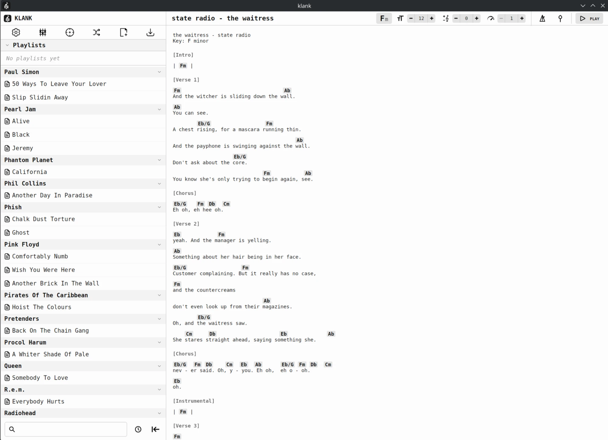
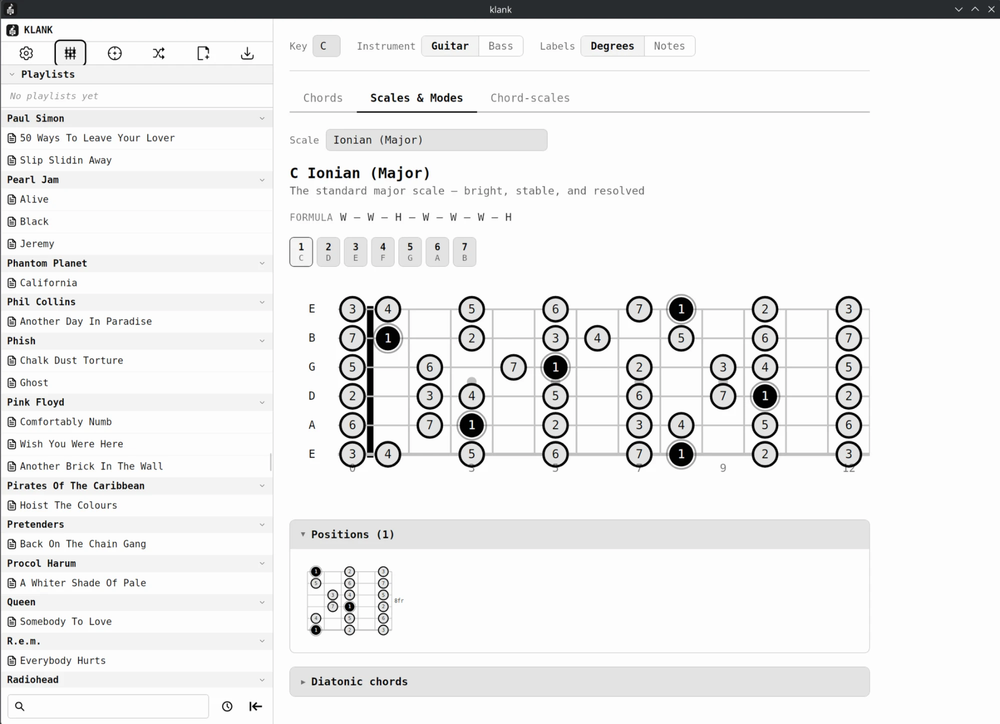
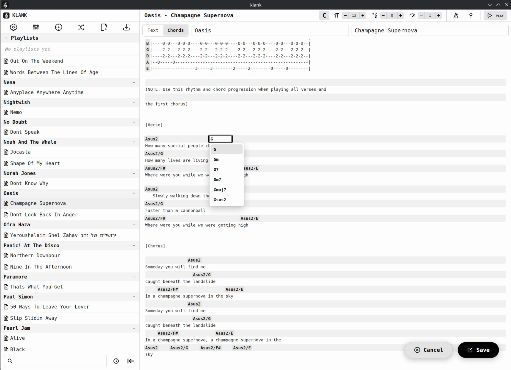
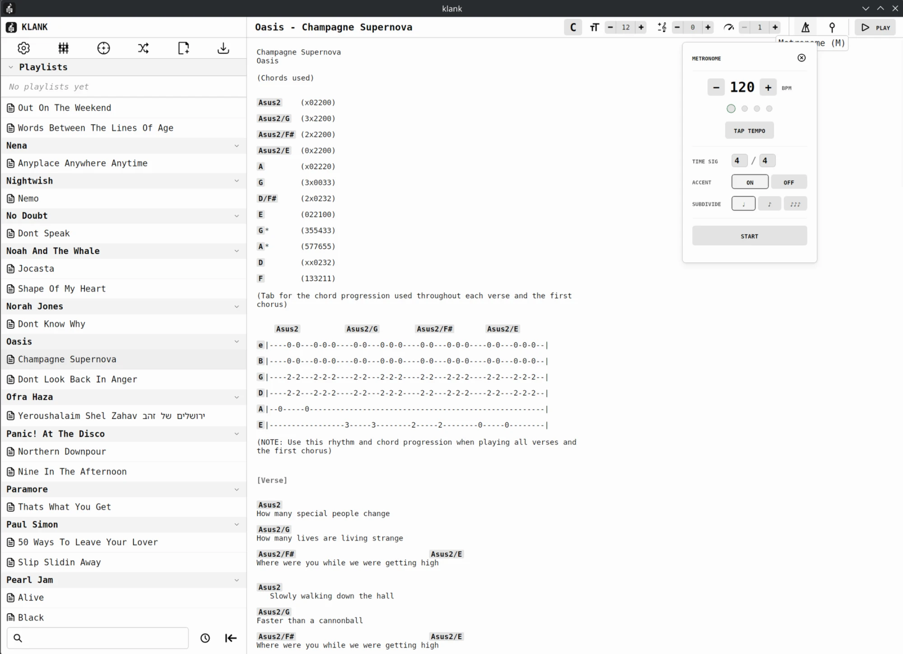

# Klank

Klank is a desktop and Android app for guitarists and bassists who keep their guitar tabs as plain text files.

## What it does

- Browses a local folder of tabs grouped by artist, with full-text search that highlights matches in the file tree.
- Highlights chords inside a tab, shows guitar or bass fingering diagrams on hover, and transposes the whole tab by semitones.
- Scrolls a tab automatically at an adjustable speed, and plays tabs in order from named, drag-and-drop playlists.
- Includes a metronome with tap tempo, time signatures and subdivisions, a listen-only tuner with reference tones, and a scale and mode browser with fretboard diagrams.
- Hosts a jam session on the local network that shares the open tab, its transposition and the live scroll position with other devices.
- Imports tabs from a tab website, syncs the tab folder with a git repository, and can send a song link to Anvil, a separate chord-sheet service, and list its jobs.

## How it is built

- A Tauri 2 app: a React 19 and React Router 7 front end built with Vite, and a Rust back end.
- An Nx monorepo managed with pnpm, with shared libraries for UI components, a Zustand state store, audio, and a platform layer that keeps the React code independent of Tauri.
- The back-end logic (git sync, tab import, jam transport, file and settings storage) sits in a Rust crate with no Tauri dependency, so the same code also runs as a headless HTTP and WebSocket server in a Docker image.
- Jam devices find each other over mDNS; two small custom Tauri plugins handle the Android-specific parts.
- CI builds a Windows installer, Linux AppImage and deb packages, and an Android APK for each release; desktop builds update themselves in the app.

## Screenshots

## Status

Version 2.0.0, released for Windows, Linux and Android. The server image still builds, but is no longer published or hosted.

## Code

Source code: https://github.com/hampterworks/klank
